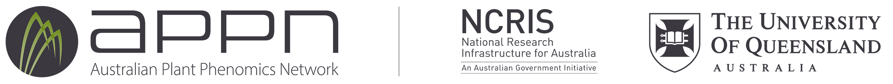

<div style="font-family: Arial, sans-serif;">

# SeedLabeler


Desktop app for stereo seed phenotyping. Supports Sony RX0 stereo pairs and Luxonis OAK-D cameras (chosen per project). Captures seed images, measures 3D traits (length, width, thickness, volume, colour, shape), trains per-crop instance-segmentation models, and exports publication-ready trait tables.

## Project Information

**Project Title:** SeedLabeler -- 3D Seed Phenotyping Workstation

**Maintainer:** Daniel Smith (APPN UQ)

## Project Description

SeedLabeler turns a pair of cameras and a printed stage sheet into a seed measurement station. The deliverable is **traits tables** (per seed and per sample: size, shape, colour, thickness, volume, uniformity). Along the way, every corrected sample becomes training data, so the app trains an instance-segmentation model for each crop and uses it as the detector for future samples.

Builds on [`chickpea-seed`](https://github.com/APPN-UQ/ChickpeaSeed) (stage, top-down view, segmentation, traits) and [`sonyrx0`](https://github.com/APPN-UQ/SonyRX0) (cameras, calibration, depth).

## Installation and Setup

### One-step install (any Windows PC)

1. Get the three repos side by side in one folder:
   ```
   git clone https://github.com/APPN-UQ/SonyRX0
   git clone https://github.com/APPN-UQ/ChickpeaSeed
   git clone https://github.com/APPN-UQ/SeedLabeler
   ```
2. Double-click **`SeedLabeler/setup.bat`**. It finds conda (offers to install
   Miniconda if missing), creates the `seedlabeler` environment, installs PyTorch
   for this PC's GPU (CUDA 12.8, 12.6 for older drivers, or CPU), installs the
   three packages with the tested versions (`constraints.txt`), runs a self-test
   and puts a **SeedLabeler** shortcut on the desktop. Run it again after a
   `git pull`; options: `-Cpu`, `-EnvName name`, `-NoShortcut`.
3. Plug in the cameras (PC Remote mode, data cables): no drivers or Sony software
   needed. An OAK-D goes in a USB 3 (blue) port; no drivers either.

Without an NVIDIA GPU everything works, but SAM and detection are slower and training a model takes much longer.

### Auto-updates

The app checks GitHub Releases on startup. When a new version is available a dialog offers to download and install it automatically. Running from source? Just `git pull` and re-run `setup.bat` if dependencies changed.

## Usage

### Workflow

| Step | Mode | What happens |
|------|------|-------------|
| 1 | **LABEL** | Capture ~20 samples, detect seeds, correct outlines, add to dataset |
| 2 | **TRAIN** | Train the crop's model on them (hub or LABEL toolbar) |
| 3 | **CAPTURE** | Collect the rest quickly with live view and barcode scanning |
| 4 | **PROCESS** | Batch-detect everything, review flagged samples, export CSV |

You can enter CAPTURE mode at any time to collect imagery. A trained model is only needed for PROCESS (batch detection). After training, the model becomes the detector so future LABEL samples start from its predictions. Add another batch, retrain, repeat.

### Screens

**Home**: recent projects, NEW PROJECT (name, location, crop, calibration, camera settings) and OPEN PROJECT.

**Hub**: counts (captured, to process, labelled samples and seeds, models), the suggested workflow with the next step highlighted, and the four modes.

**LABEL**: capture or import, detect + SAM, correct outlines, tag seeds, add to dataset, train. Switch between RGB and depth map views. Opacity slider controls seed overlay transparency.

**CAPTURE**: live view with stage markers; scan barcode or type a sample ID, capture, next. Instant quality checks (images saved, sharpness, exposure, depth coverage).

**PROCESS**: table of samples with status flags (LOW DEPTH, COUNT?, NO SEEDS, L/R FIXED). PROCESS NEW / PROCESS SELECTED in background. Double-click to open in LABEL. EXPORT CSV.

### Editing seeds in LABEL

| Action | Effect |
|--------|--------|
| Click | Select a seed (also selects its row in the table) |
| Drag seed / white handle | Move the seed / a single vertex |
| Double-click an edge | Insert a vertex |
| Right-click a vertex | Remove it |
| **Right-click a seed** | **Tag it with a label (broken, damaged, etc.)** |
| `Delete` | Delete selected seeds |
| **BOX** (SAM) | Drag a box around a seed, or click one; then click to include, Shift/right-click to exclude |
| **SAM FIX** or `R` | Redraw the selected seed with SAM |
| **REFINE ALL** | Redraw every automatic outline with SAM |
| Wheel / middle-drag / `Space`+drag / `F` | Zoom, pan, fit |
| Opacity slider | Adjust seed overlay transparency |

### Seed labels

Right-click any seed to tag it from a configurable list of labels (e.g. broken, damaged, discoloured, double, immature, shrivelled). Labels appear in the TAG column of the table and in the exported CSV. Configure the label list per project in **Settings > SEED LABELS** (comma-separated).

Tagged seeds are outlined in a distinct colour so they stand out visually.

### Camera systems

**Sony RX0 stereo pair**: two cameras with stereo calibration. Requires a calibration session (guided wizard in Settings or `rx0-calibrate` CLI). Live view from the left camera.

**OAK-D**: one camera with colour (12 MP) and stereo depth; uses its factory calibration. Live view shows distance to the stage -- keep it **40 cm or more** (depth starts at 33 cm). A capture saves `raw/rgb.jpg` and `raw/depth.npz` (median of 10 depth frames aligned to colour) in ~4 s. Camera settings: `--exposure 8000 --iso 400 --wb 5000` (us, K; `auto` for any).

### Corner markers (recommended for the lab)

**Settings > GROUND PLANE > Corner markers**, then **PRINT SHEET** (A4 or A3): a sheet with a small ArUco marker in each corner. Print at 100% ("Actual size"), tape it flat, measure its **100 mm bar** with a ruler and enter the measurement (printers often shrink: an A3 sheet fitted onto A4 measured 68 mm). Seeds go between the markers.

In every capture the markers:
- Give the stage plane automatically
- Correct the depth scale (must agree with printed size)
- Limit detection to the sheet area (tiles outside the markers are skipped)

**LEVEL HEIGHT** measures each seed against the sheet around it rather than one flat plane (recommended for OAK-D, whose depth bends by a few mm across the view).

### Colour calibration

On first entry to LABEL or CAPTURE each session, a calibration dialog prompts you to photograph a ColorChecker chart. The resulting colour correction matrix is saved per project and **snapshotted into each sample** at detect time, so if you recalibrate after changing lighting conditions, old samples keep their original calibration and new samples use the new one.

### SAM

SAM (Segment Anything) runs on a full-resolution crop around each prompt; it separates seeds from their shadows. Pick the model in Settings: MobileSAM (~30 ms/seed) or SAM 2.1 base (~100 ms, sharper). Weights download once to `~/.seedlabeler/weights`. **SAM AFTER DETECT** runs REFINE ALL automatically after every detection.

### Models

- **ADD TO DATASET** writes corrected outlines in YOLO segmentation format with ~80/20 train/val split. Images are resampled to ~64 px across the seed width and cut into overlapping 640 px tiles.
- **INPUT**: COLOUR or COLOUR + HEIGHT (height helps distinguish seeds from shadows/stains of the same colour).
- **TRAIN** fine-tunes a pretrained model on the GPU in a background process with a live log.
- Pick the detector (CLASSIC or a trained model with its validation mask mAP) next to DETECT.
- Each crop gets its own dataset and models.

Ultralytics YOLO is AGPL-3.0: fine for research use, check before distributing.

### Moving between PCs

- **Projects are self-contained**: calibration, rig.json and stage file are stored inside `<project>/calibration/` as relative paths. Keep projects in OneDrive to have them on both PCs.
- **Code**: `git pull` in each repo, then run `setup.bat` if dependencies changed. Or use the auto-updater in the packaged app.
- Don't open the same project on two PCs at once.
- SAM weights download again on each new PC (~40--150 MB).

## Project structure

```
<project>/
  project.json                      # name, crop, calibration, detector, settings
  calibration/
    calib.npz                       # stereo calibration (RX0)
    rig.json                        # which camera is left/right
    stage_sheet.json                # marker layout
    colourcal.json                  # colour calibration matrix
  samples/<id>/
    raw/left.jpg, right.jpg         # RX0 stereo pair
    raw/rgb.jpg, depth.npz          # OAK-D colour + depth
    ortho.png                       # top-down stage image
    height.npz                      # height map + valid mask
    meta.json                       # resolution, stage, detector used
    annotations.json                # seed polygons, status, labels
    colourcal.json                  # colour calibration snapshot for this sample
    <id>_seeds.csv                  # per-seed traits
    <id>_summary.csv                # per-sample summary
  datasets/<crop>/                  # YOLO segmentation dataset
  models/<crop>/                    # trained model runs
  exports/                          # exported CSV files
```

## Tests

```
pytest tests -s
```

Runs import, detect, edit, remeasure, dataset, export on a real almond pair, plus offscreen GUI checks. `tests/test_markers.py` checks the stage sheet, corner-marker plane, depth-scale correction and the OAK colour + depth path on a synthetic scene.

## Contact

**APPN UQ:** appn@uq.edu.au

## Acknowledgments

This research is supported by the Australian Plant Phenomics Network (APPN) and The University of Queensland. We acknowledge the use of the facilities, and scientific and technical assistance of APPN, which is supported by the Australian Government's National Collaborative Research Infrastructure Strategy (NCRIS).



</div>
